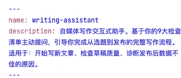
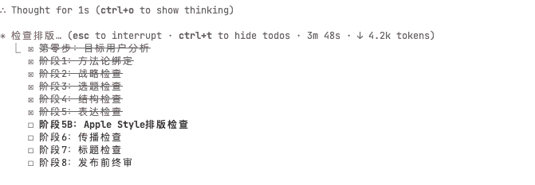
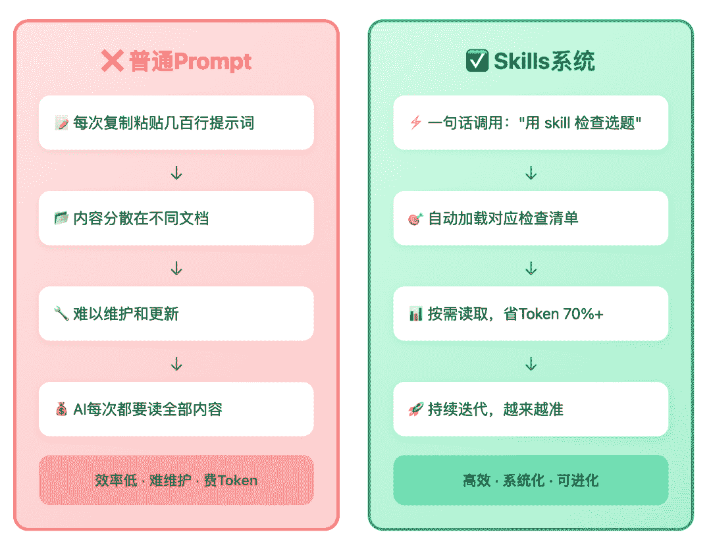
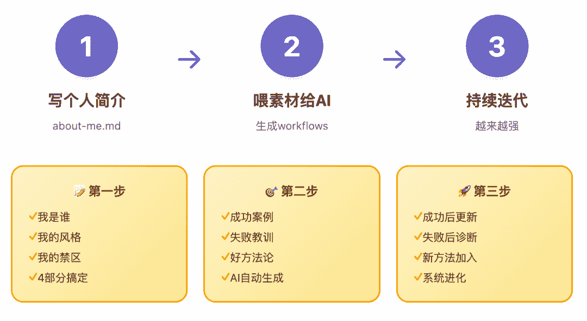
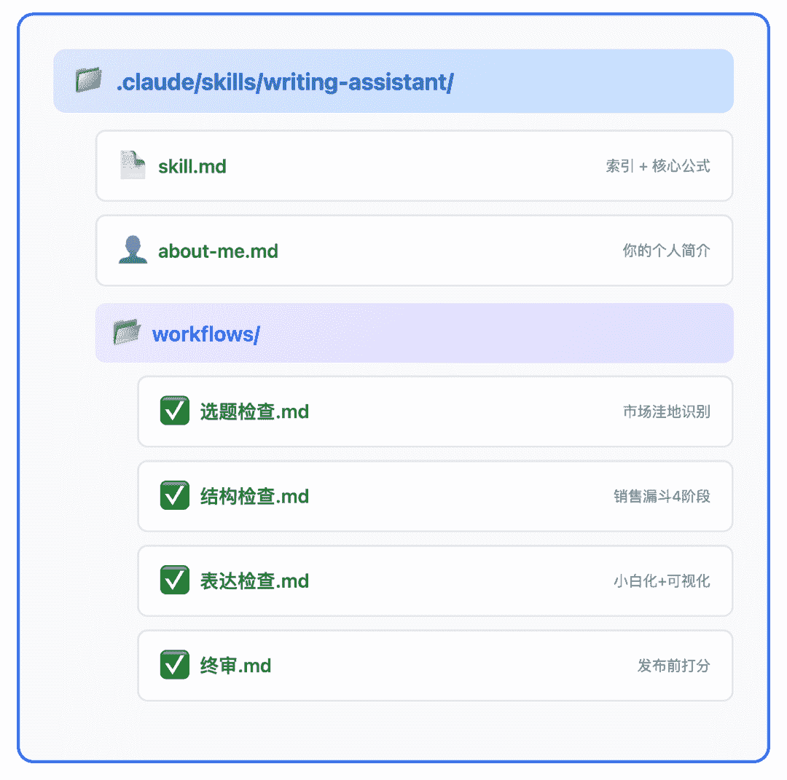
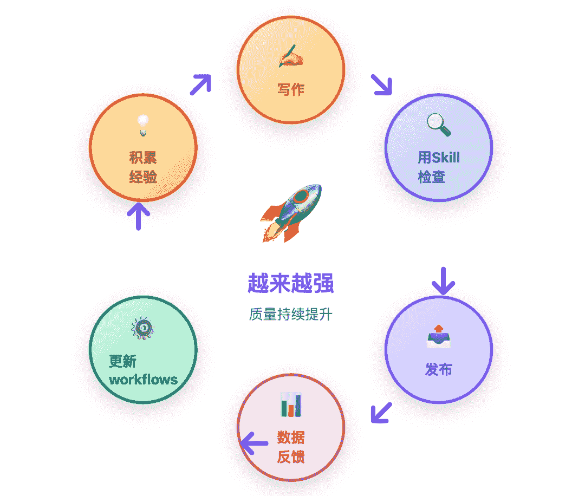

# Claude code skills 怎么用来写作？

> 来源：[https://xatc0v8uz5m.feishu.cn/docx/LtXIdGq3Po9Gqsxx4xkcL5HFn5v](https://xatc0v8uz5m.feishu.cn/docx/LtXIdGq3Po9Gqsxx4xkcL5HFn5v)

> 🔗 原文链接： h[ttps://mp.weixin.q](https://mp.weixin.qq.com/s/nJGd5nB-6O2rZRjHKaCPBA)q.com/s/nJGd5nB-...

> ⏰ 剪存时间：2025-11-18 22:18:03 (UTC+8)

> ✂️ 本文档由 [飞书剪存 ](https://www.feishu.cn/hc/zh-CN/articles/606278856233?from=in_ccm_clip_doc)一键生成

原创 我是成峰 AI产品自由2025年11月18日 07:38

嘿！我是成峰。

---

你是不是也有这样的困扰：让AI写文章很慢，或者不符合自己的要求

---

我之前也是这样！直到我发现了一个关键点： 不要让AI替你写，要让AI帮你检查！

---



用Claude Code的Skills功能写作，会发现方便了很多！

---

关键在于可以把我的写作方法论放到Claude Code里面，它直接自动帮我完成检查，而不是我事后手动去检查。

---

这个功能让我的文章质量变得非常稳定！

---

今天重点讲 写作 Skills 系统 - 这是我实战总结出来的核心方法！🔑

---

# **写作前的准备（两步）**

---

## 第一步：找信息和素材

---

我会去市面上搜集最新的信息：

---

1. 📕 - 看趋势和热点

---

2. 👸号数据监控 - 找高质量文章学习

+   我自己开发了👸号数据监控系统

+   正在研究用它做更多的数据分析

+   看一下数据好的文章有什么可以学习的

---

## 第二步：语音口述内容

---

这一步我只用 语音 把内容全部讲出来！

---

为什么用语音？

+   比打字方便很多！⚡

+   思维可以更快地表达，不用停下来想怎么打字

+   用闪电说（语音转文字）质量很好

---

说完后，让Claude Code按框架生成内容。

---

OK，准备工作完成！下面进入重点 👇

---

# Skills辅助写作系统（核心！）

简单说： Skill可以用来一步步辅助写作。

---

claude code 实践清单



---

## 为什么要用Skills而不是普通Prompt？

---

关键优势：Skills是Claude官方工具！ 🎯

---

1. 自动识别 ⚡

+   在Claude Code里会自动显示

+   不用每次复制粘贴长提示词

+   一句"用写作 skill 检查"就能调用

---

2. 系统化组织 📚

+   帮你把工作流和知识库整理成标准结构

+   模块化管理，按需加载

+   省Token 70%+（只读需要的部分）

---

3. 持续进化 🚀

+   成功案例直接更新到 workflows

+   失败教训自动加到警示

+   方法论不断沉淀，越用越强

---

Skills vs 普通Prompt对比



---

实际对比 ：

---

传统AI写作：

```
你：&quot;帮我写一篇XX文章&quot;
AI：生成一篇千字文
结果：❌ 质量不稳定、❌ 无法复现、❌ 经验无法积累
```

---

用Skill的AI写作：

```
你：&quot;用写作 skill 看一下这篇文章&quot;
AI：按照你的方法论逐项检查
结果：✅ 质量稳定、✅ 可复现、✅ 经验持续沉淀
```

---

本质区别 ：AI从"创作者"变成"质检员"！

---

# 怎么建立自己的Skills系统？3步搞定！

---

3步建立你的Skills系统



---

## 核心逻辑：不是你手动写600行，而是让AI帮你填充！

---

很多人以为建立Skills要自己手动写辅助系统，其实不是！

---

传统做法 ：

```
你：手动写600行辅助内容
结果：❌ 累死累活、❌ 难以维护、❌ 容易遗漏
```

---

我的做法 ：

```
你：写个人简介 + 喂素材给AI → AI自动生成 workflows
结果：✅ 省时省力、✅ 自动更新、✅ 系统完整
```

---

关键转变 ：把隐性经验显性化，然后让AI帮你系统化！💪

---

我看《罗永浩和他的朋友们》里 Tim 讲的"短视频合集 > 短视频"，立刻记到素材里 → AI帮我生成检查项：“是否符合合集逻辑？”

---

## Skills 的架构（一开始就用这个）

---

模块化结构，高效省Token！

---

Skills目录架构



---

好处 ：

+   按需加载，AI只读需要的部分，省Token 70%+ 💰

+   案例直接在 workflows 里，检查时对照方便 ✅

+   结构清晰，易维护 ✅

---

用的时候 ：

+   “用 skill 检查选题” → AI只读 workflows/选题检查.md

+   “用 skill 做终审” → AI只读 workflows/终审.md

---

## 第一步：写个人简介 - about-me.md

---

这是你的名片，告诉AI你是谁。

---

只需要写4部分 ：

---

```
## 我是谁
- 领域：AI编程
- 受众：AI工具使用者、开发者

---

## 我的风格
- 小白化表达
- 数据驱动
- 实战导向

---

## 我的禁区
- 不跳过认知阶段
- 不做单一人群内容
```

---

为什么是简介？ 让 AI 知道你的定位和边界，检查内容是否符合你的方向！

---

## 第二步：喂素材给AI，生成 workflows

---

把你的成功案例、失败教训直接给AI，让AI帮你生成辅助写作系统！

---

准备3类素材 ：

---

1. 成功案例 ✅

---

```
CLI教程为什么1000+赞？
→ 覆盖3类人群（文字工作党、开发者、效率提升者）
→ 内容密度好（54行/章）
```

---

把你的成功案例记录下来，AI会帮你提取成功要素。

---

2. 失败教训 ❌

---

```
拓展插件教程为什么数据差？
→ 跳过认知阶段（没有&quot;为什么&quot;章节）
→ 信息重复60%（系列第2篇）
```

---

失败也是宝贵经验，AI会帮你生成警示检查项。

---

3. 好方法论 💡

---

```
看到好观点立即记录：

---

罗永浩和他的朋友们里 Tim 说：
&quot;短视频合集 &gt; 短视频&quot;

---

我的理解：
短文合集 &gt; 短文
→ AI生成检查项：&quot;是否符合合集逻辑？&quot;

---

其他方法论：
→ 销售漏斗：认知→兴趣→决策→行动
→ 市场洼地：需求高×供给低×时机早
```

---

看到好方法论立即记录，AI会转化成具体检查项。

---

然后用提示词让AI生成 ：

```
我要建立 writing-assistant skill，帮我生成辅助写作系统。

---

我的定位：[about-me.md 内容]

---

检查框架：
- 写作前：目标用户、选题验证、先验调研
- 写作中：结构检查、表达优化
- 发布前：标题优化、终审打分
- 发布后：数据诊断

---

我的成功案例：
[粘贴上面的成功案例]

---

我的失败教训：
[粘贴上面的失败教训]

---

我的方法论：
[粘贴上面的方法论]

---

要求：
1. 生成 workflows 目录，每个检查维度一个文件
2. 每个文件包含：具体检查项（checkbox）+ 我的成功/失败案例对照
3. 标注重要程度（⭐数量）
```

---

AI会自动帮你生成 ：

+   skill.md（索引 + 核心公式）

+   workflows/选题检查.md（含你的成功/失败案例）

+   workflows/结构检查.md（含你的成功/失败案例）

+   workflows/…（其他检查维度）

---

案例直接在 workflows 里，检查时随时对照！

---

## 第三步：持续迭代 - 让 workflows 越来越强

---

这是Skills越来越强的秘诀！

---

持续迭代循环



---

每次写作后，直接让 AI 更新 workflows：

---

如果成功了 ✅

---

```
提示词：
&quot;我的XX文章数据很好（具体数据），帮我分析成功原因，
然后更新 workflows/相关检查.md，加上这个成功案例的对照。&quot;

---

AI 会自动：
→ 分析成功要素
→ 更新对应 workflow 的成功案例区
→ 调整检查项权重
```

---

如果失败了 ❌

---

```
提示词：
&quot;我的XX文章数据不好，帮我诊断问题，
然后更新 workflows/相关检查.md，加上这个失败教训的警示。&quot;

---

AI 会自动：
→ 定位失败原因
→ 更新对应 workflow 的失败案例区
→ 加强相关检查项
```

---

看到好方法 💡

---

```
提示词：
&quot;我看到一个好观点：[方法论]，
帮我生成对应的检查项，加到 workflows/相关检查.md 里。&quot;

---

AI 会自动：
→ 理解方法论
→ 生成具体检查项
→ 更新到对应 workflow
```

---

这样的好处 ：

+   案例直接在workflows里，对照方便 ✅

+   about-me.md 保持简洁，只是个人简介 ✅

+   workflows 不断进化，越来越精准 ✅

---

Skill会越来越强！ 🚀

---

# **最后：排版和发布**

---

Skill检查完，就可以发布了！

---

我用 Obsidian + AI 排版，一键复制到👸号。

---

（Obsidian工作流后面单独写，今天重点是Skills！）

---

# **写在最后**

---

很多人以为AI写作就是让AI帮你写，但我的实践证明：

---

真正有效的AI写作 ≠ 让AI替你写

---

真正有效的AI写作 = 让AI执行你的方法论

---

这套工作流的核心不是工具，而是一个闭环：

1.  写个人简介（about-me.md）- 告诉AI你是谁

1.  喂素材给AI，生成 workflows - 把经验系统化

1.  每次写作用Skills检查 - 质量稳定

1.  成功/失败后让AI更新 workflows - 持续进化

---

把每次成功和失败都转化成可复用的方法论，让AI帮你系统化执行，这才是AI时代写作者的真正壁垒。 🚀

---

不用手动写600行，AI帮你搞定！你只需要：

+   写一个简洁的个人简介

+   把经验喂给AI

+   让AI不断优化你的辅助写作系统

---

就这么简单！

---

💬 想了解完整工具链和交流？ 加群 👇


v


---