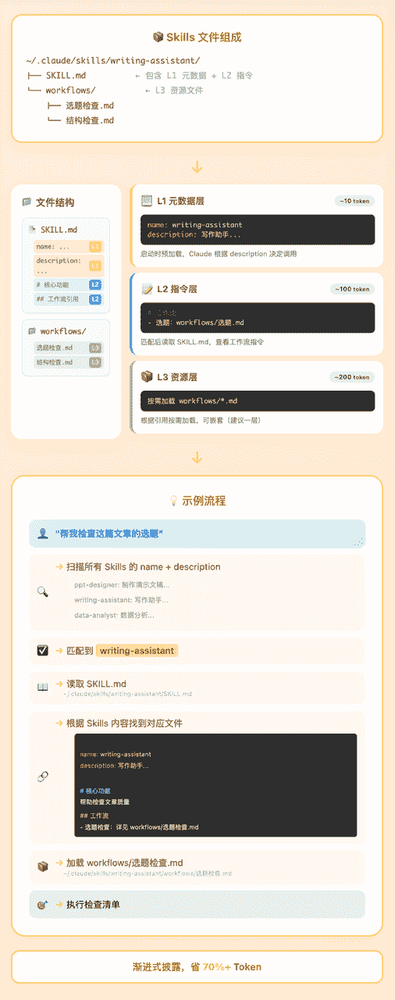
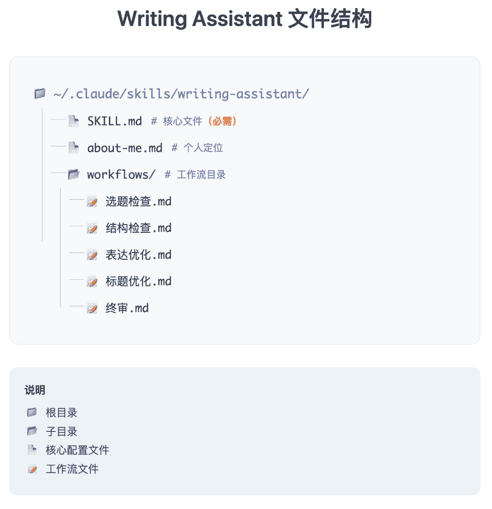
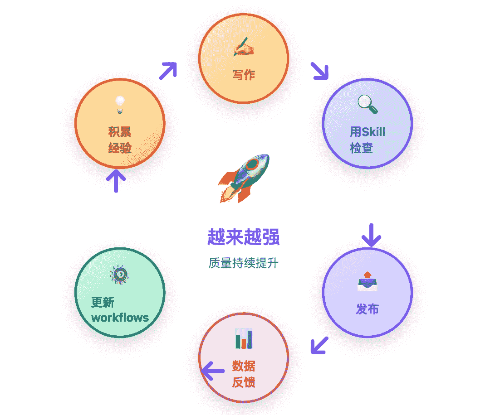

# Skills 新手教程：如何创建一个写作 Agent

> 来源：[https://xatc0v8uz5m.feishu.cn/docx/AFSOd5U3GoujdExvNGXc8saAn6t](https://xatc0v8uz5m.feishu.cn/docx/AFSOd5U3GoujdExvNGXc8saAn6t)

> 🔗 原文链接： h[ttps://mp.weixin.q](https://mp.weixin.qq.com/s/-YPA2Ee1eeXKIAlLUHS4hw)q.com/s/-YPA2Ee1...

> ⏰ 剪存时间：2025-11-19 18:12:14 (UTC+8)

> ✂️ 本文档由 [飞书剪存 ](https://www.feishu.cn/hc/zh-CN/articles/606278856233?from=in_ccm_clip_doc)一键生成

原创 我是成峰 AI产品自由2025年11月19日 07:30

昨天我写了一个 Skills 的写作教程，很多人问：小白怎么从零开始写 Skill？

群内沟通


在讲"怎么做"之前，我们先讲清楚 Skills 的设计逻辑。理解了设计理念，你才能真正用好它。

前情提要： Claude code skills 怎么用来写作？

---

## 第一部分：Skills 的设计逻辑

### 1. Skills 的本质

> 核心定义 ：Skills 把上下文管理抽象成了文件夹的概念。

---

传统 AI 应用的痛点 ：

+   提示词越写越长 → 上下文爆炸

+   Token 成本越来越高 → 处理效率低

+   知识无法模块化 → 难以复用和迭代

---

关键创新 ：

通过文件系统来组织上下文，而不是把所有内容塞进提示词。

---

### 2. Claude 的三层架构设计

> 这是 Skills 最核心的设计： 渐进式披露 （Progressive Disclosure）

---

三层架构



---

## 第二部分：AI 自动生成 Skills

### 1. 一键生成提示词

不需要自己写代码，直接用这个提示词让 AI 帮你生成完整的 Skill 结构。

---

使用方法 ：

把相关的内容填到下面的表里，然后复制到 AI。

---

```
我要创建一个 [领域] Skill，帮我生成完整结构。

## 基本信息
- Skill 名称：[例如：writing-assistant]
- 领域：[例如：自媒体写作]
- 使用场景：[例如：检查文章质量、诊断数据不佳原因]

## 文件位置
生成到：~/.claude/skills/[skill名称]/

## 核心功能
我需要这个 Skill 帮我：
1. [功能1 - 例如：写作前的选题检查]
2. [功能2 - 例如：写作中的结构优化]
3. [功能3 - 例如：发布前的终审打分]

## 架构要求
1. 生成完整的 YAML frontmatter（name + description）
2. 在 workflows/ 目录创建独立的检查文件
3. 每个 workflow 包含：
   - 具体检查项（checkbox 格式）
   - 重要程度标注（⭐数量）
4. 使用渐进式披露结构（SKILL.md 引用 workflows）

## 输出格式
请按照以下结构生成所有文件内容：

1. 先生成目录结构说明
2. 然后逐个文件输出完整内容
3. 最后提供安装和验证步骤
```

AI 会自动生成 一个完整的 Skill 了！

---

如果你想要我的写作 Skill，也可以使用上面的提示词模板。

```
复制这个文档 https://github.com/Ceeon/writing-assistant-skill 生成到：~/.claude/skills/
```

---

### 2. 文件路径说明

> Skills 建立好以后，应该存放在个人目录： ~/.claude/skills/你的skill名称/

---

生成的文件结构 ：



---

三个核心文件的作用 ：

1.about-me.md - 你的个人档案

+   领域定位、写作风格

+   成功案例、失败教训

+   让 AI 知道你是谁，检查内容是否符合你的方向

---

2.skill.md - 主索引文件

+   包含 name 和 description（L1 元数据）

+   引用各个 workflows 文件的路径（L2 指令）

+   Claude 先读这个文件，再按需加载对应的 workflow

---

3.workflows/ - 具体的检查清单（L3 资源层）

+   每个文件对应一个检查维度（如选题、结构、标题等）

+   包含具体检查项、案例对照

+   按需加载，省 Token

---

### 3. 验证 Skill 是否生效

方法1 - 询问可用 Skills：

```
&quot;我有哪些可用的 Skills？&quot;
```

---

方法2 - 直接测试：

```
&quot;帮我检查一下这篇文章&quot;
# 如果是写作 Skill，Claude 应该会自动调用
```

---

## 第三步：持续迭代 - 让 workflows 越来越强

> 这是 Skills 越来越强的秘诀！

---

持续迭代循环



---

每次写作后，直接让 AI 更新 workflows。

---

### 成功案例 ✅

记录什么有效 ：

```
CLI 教程为什么 1000+ 赞？
→ 覆盖了 3 类人群（文字工作党、开发者、效率提升者）
→ 内容密度好（54 行/章，每段都有信息点）
→ 实战导向（每一步都有具体代码）
→ 小白化表达（没有跳过认知阶段）
```

---

### 失败教训 ❌

记录什么无效 ：

```
拓展插件教程为什么数据差？
→ 跳过认知阶段（没有&quot;为什么&quot;章节）
→ 信息重复 60%（系列第 2 篇，与第 1 篇重复）
→ 受众太窄（只有开发者感兴趣）
→ 缺少使用场景（用户不知道什么时候用）
```

---

### 好方法论 💡

从别人那里学到的 ：

> 罗永浩播客里 Tim 说：“短视频合集 > 短视频”

---

我的理解 ：

```
短文合集 &gt; 短文
→ 生成检查项：&quot;是否符合合集逻辑？&quot;
```

---

💬 了解和交流？ 加群 👇


v

