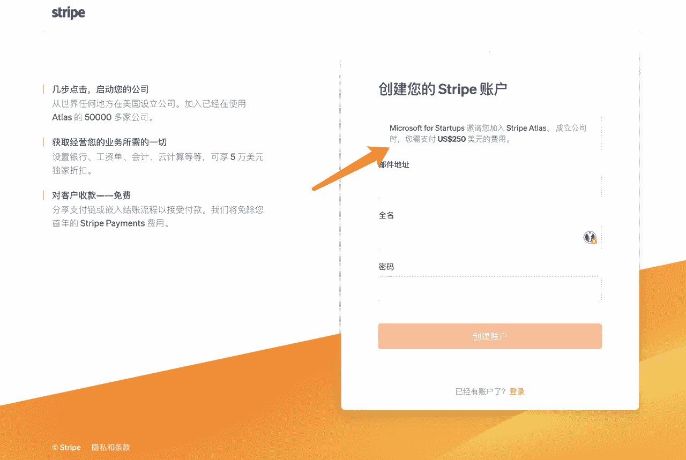

# 注册美国公司 - 完整指南 2025 | Stripe Atlas vs DIY怀俄明州 Wyoming 方案对比 - 150刀注册美国公司 – 一站式解决你的收款问题

> 来源：[https://xatc0v8uz5m.feishu.cn/docx/ZJ9KdpFfUowJmExd4ncclyQUnab](https://xatc0v8uz5m.feishu.cn/docx/ZJ9KdpFfUowJmExd4ncclyQUnab)

> 🔗 原文链接： h[ttps://www.setupyo](https://www.setupyourpay.com/docs/us-company-registration)urpay.com/docs/u...

> ⏰ 剪存时间：2026-01-05 16:48:39 (UTC+8)

> ✂️ 本文档由 [飞书剪存 ](https://www.feishu.cn/hc/zh-CN/articles/606278856233?from=in_ccm_clip_doc)一键生成

手册

注册美国公司 - 完整指南 2025 | Stripe Atlas vs DIY怀俄明州 Wyoming 方案对比 - 150刀注册美国公司

详细介绍如何在美国注册公司，包括Stripe Atlas和DIY方案的优劣对比、注册流程、所需材料、费用明细及税务考量

##  注册美国公司需要多少钱？

通过方案2最低仅需150刀就可以注册一个美国公司，相比国内注册公司，费用低廉，并且流程简单，并且可以开启全球的生意，美国公司不仅支持向海外收取信用卡的支付，也支持开通微信和支付宝收款。 拥有美国公司更加国际化，可以更容易的获得海外客户的信任，出海获得更高的收益。一个现实是，欧美地区的客户对于产品更愿意付费，亚洲地区的客户更愿意使用免费产品。站长在注册美国公司之后， 也实打实接触到了很多国际客户，在 2025 这个国内经济严重内卷的时代，出海是一个非常需要考虑的选项。

美国公司的税收对于非美国税民非常友好，详情我们后面会详细介绍。

##  开始之前的重要提醒

注册美国公司虽然现在变得相当便捷，但这仍是一个需要认真对待的决定。在注册公司之前，你需要了解：

+   需要按时完成年度审计和税务申报

+   如果注册后疏于管理，可能会影响个人征信记录

+   征信记录的损坏可能影响未来的美国签证申请

+   如果不再经营，应当及时办理公司注销手续

##  注册公司需要的资料

这一步需要提交的资料是最少的，但是也是最需要注意的，在开始前需要准备好的资料

1.  创始人信息及家庭住址 家庭住址可以是国内地址，有咨询的时候，有用户说，害怕中文地址不给过 完全不用担心，外国人注册美国人公司是完全合法的。只需要提供对应的地址证明即可。 ⚠️ 你在注册公司的时候，填写的地址，必须是先有材料能证明这个地址，才填写上去，而不是填写了地址 才发现自己没有材料可以证明这个自己和你有联系 可以是：

1.  水电费账单

1.  信用卡账单

1.  这里也可以通过办理港卡，得到一份中英文的地址对账单，更方便审核（如果英文地址可以提交这个）

1.  驾照翻译件（如果你提交的是英文地址，可以提交这个）

1.  准备好护照个人页的照片，会经常用到

##  注册公司带来的改变

注册公司不仅仅是一个法律程序，更会带来深层的心理转变（心理学中的「角色认同理论」）：

注册公司对我心态上的改变，当你成立一家公司为主体之后， 行为心理学中的「自我实现预言」效应 开始显现：我开始以企业家的身份框架重新定义自己的决策模式，这种角色转换会带来：

+   从个人身份转向企业经营者身份（社会心理学中的「角色认知重构」）

+   更容易以商业视角发现市场机会（认知心理学中的「框架效应」）

+   提供更规范的经营框架（行为经济学中的「承诺机制」）

+   增强品牌公信力（社会心理学中的「权威效应」）

**心理学机制解释：**

1.  通过「认知失调理论」推动行为改变 - 当公司主体存在时，个体会主动调整行为以符合企业家身份

1.  触发「沉没成本效应」增强投入度 - 注册流程的投入会转化为更强的经营承诺

1.  形成「心理账户」区隔 - 将个人财务与公司财务分离，提升决策理性

1.  产生「标签效应」 - 被外界视为企业主后，会不自觉地提升专业表现

##  请选择您的注册方案

###  1. Stripe Atlas 方案

由于 Stripe Atlas 仅支持在特拉华州注册，目前仅在前期公司维护成本高（每年固定要交300刀）。Stripe Atlas 的使用体验非常好，注册过程丝滑，dashboard 好用。10w刀一年的免手续费。手续费可以省下非常多。如果你在一年内满打满算赚够100k刀，总计手续费可以省下3000刀

| 类别 | 项目 | 说明 |
| --- | --- | --- |
| 💫 主要优势 | 注册流程 | 全程在线，操作简单顺畅 |
|  | 管理系统 | 直观的管理面板，易于使用 |
|  | 支付优惠 | 首年 $100,000 交易免手续费  （可节省约 $3,000） |
|  | 办理方式 | 100% 在线办理，无需亲自到场 |
| 💰 费用明细 | 注册费用 | $500 基础费用  （使用推荐码可减至 $250） |
|  | 年度支出 | $300/年（特拉华州LLC特许经营税,C-company会更高） |

##  特拉华州税收优势

特拉华州是美国最受欢迎的公司注册地之一，其中一个重要原因是其税收政策：

+   无州级销售税

+   对州外经营收入免征州所得税

+   对非居民股东的分红收入免征州预扣税

###  开始注册

###  创建账号

[Stri](https://dashboard.stripe.com/register/atlas?atlas_invite=prod-microsoftforstartups-AWDRty)pe Atlas 原本的注册费是500刀，通过 此链接 注册仅需250刀，请注意，需要新账号才可以使用这个优惠。如果之前已经注册过，Stripe 需要重新开一个账号来注册 Stripe Atlas

访问注册平台官网并创建企业账户（建议使用企业邮箱注册）

###  选择公司类型

根据业务需求选择公司类型：

+   LLC（有限责任公司）：适合小规模经营，税收更灵活

+   C-Corporation：适合计划未来融资的创业公司，维护成本也更高一点

###  输入公司名称

需包含公司类型后缀（如LLC/Inc.等），系统会自动校验名称可用性

---

[🌏 国际个人支付渠道 🏦](https://www.setupyourpay.com/docs/personal-payment-international)[ 水星银行公户开通](https://www.setupyourpay.com/docs/mercury-bank-registration)