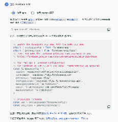
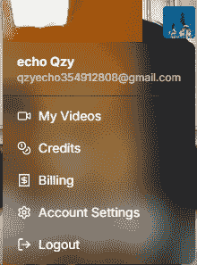

# 存储桶和cloud shell

> 来源：[https://xatc0v8uz5m.feishu.cn/docx/Z2oEdaZOWoWxoRx4wnFczmU9nHh](https://xatc0v8uz5m.feishu.cn/docx/Z2oEdaZOWoWxoRx4wnFczmU9nHh)

存入进去的图片放到存储桶里面

要打开公开权限，提供获取

https://gemini.google.com/share/92c5bda801aa

浏览器的CORS（跨源资源共享）安全策略，而不是代码逻辑。

我之前的分析是基于您提供的代码，我们通过排查代码中的 pexelsP**arams 错误，确保**了您发送给 fetch 函数的 URL 是干净且正确的。这是解决问题的第一步，也是必要的一步。

但是，我们遇到了第二层问题，也就是这个新答案所指出的：

1.  **问题核心：** 您的网页应用（运行在您的域名上）的 JavaScript 试图通过 fetch() 函数去“抓取”一个不同域名（storage.googleapis.com）上的图片数据。

1.  **浏览器安全机制：** 出于安全，浏览器会阻止这个行为，除非 storage.googleapis.com 在其服务器响应中明确包含一个“许可”头（Header），即 Access-Control-Allow-Origin。

1.  **为什么 Pexels 能行：** imag**es.**pexels.com 服务器包含了这个许可 Access-Control-Allow-Origin: *，意思是“我允许任何网站抓取我的图片”。

1.  **为什么 GCS 不行：** 您的 GCS 存储桶即使设置了“公开”，也只是**允许直接访**问（比如在浏览器地址栏输入URL，或在  标签的 src 里使用）。它默认不包含这个 Access-Control-Allow-Origin 许可，所以浏览器的 fetch() 请求被安全策略阻止了。

这个新答案中提出的解决方案是行业标准，也是最佳的解决方案：在您的 GCS 存储桶上配置 CORS。

在 Google Cloud 中操作存储桶的详细指南

这个新答案建议使用 Cloud Shell（gcloud 命令行），这是最快、最专业的方法。我来为您提供一步步的可视化操作指南：

第 1 步：打开 Cloud Shell

1.  前往您的 Google Cloud 控制台（您一直在用的那个界面）。

1.  在右上角的菜单栏中，找到并点击 “激活 Cloud Shell” 图标。它看起来像一个 >_ 符号。

1.  点击后，屏幕底部会弹出一个黑色的终端窗口。请等待几秒钟让它完成连接。

第 2 步：创建 CORS 配置文件

1.  在 Cloud Shell 终端（黑色窗口）中，我们要创建一个名为 cors-config.json 的文件。

1.  输入以下命令，然后按 Enter 键：

1.  Bash

```
nano cors-config.json
```

1.  (这会打开一个简单易用的全屏文本编辑器 nano)

第 3 步：粘贴 CORS 配置内容

1.  现在，请**完整复制**以下这段 JSON 代码：

1.  JSON

```
[
  {
    &quot;origin&quot;: [&quot;*&quot;],
    &quot;method&quot;: [&quot;GET&quot;],
    &quot;maxAgeSeconds&quot;: 3600
  }
]
```

1.  在 Cloud She**ll** 的 nano 编辑器窗口中粘贴这段代码。

+   "origin": ["*"]：允许来自**任何**网站 ( * ) 的请求。

+   "method": ["GET"]：只允许 GET 请求（即“获取”文件）。

第 4 步：保存并退出文件

1.  粘贴完毕后，按 Ctrl + X 组合键准备退出。

1.  终端会询问您 "Save modified buffer?" (是否保存修改?)，请按 Y 键（代表 Yes）。

1.  最后，它会确认文件名，您只需按 Enter 键即可。

第 5 步：将配置应用到您的存储桶 (关键)

1.  现在您回到了黑色的命令行。我们要运行 gcloud 命令来更新您的存储桶。

1.  根据我们之前的记录，您的存储桶名称是 pose-shift-app-assets。

1.  请**复制**并运行以下命令（请确保存储桶名称 gs:// 后面是您自己的桶名称）：

1.  Bash

```
gcloud storage buckets update gs://pose-shift-app-assets --cors-file=cors-config.json
```

1.  按 Enter 键。如果一切顺利，它会更新您的存储桶，不会报错。

第 6 步：最终测试

1.  这个配置几乎是立即生效的。

1.  现在，回到您的 PoseShift 网页应用。

1.  请**务必**执行一次**强制刷新**来清除浏览器缓存：

+   Windows/Linux: 按 Ctrl + Shift + R

+   Mac: 按 Cmd + Shift + R

1.  再次尝试选择一个您 GCS 上的“Artistic Photos”图片，然后点击 "Start Trial"。

Failed to fetch 的错误现在应该已经消失了，您的应用将能成功生成图片。

# 登录



登录样式

