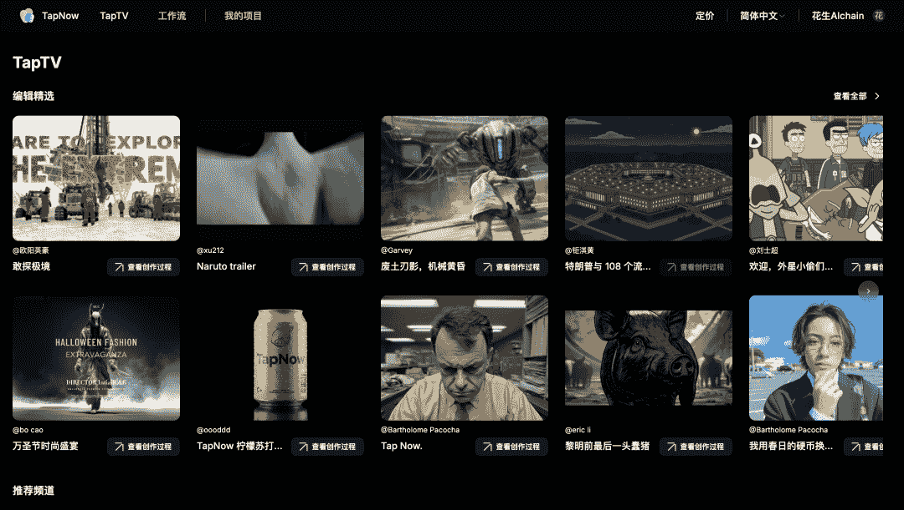
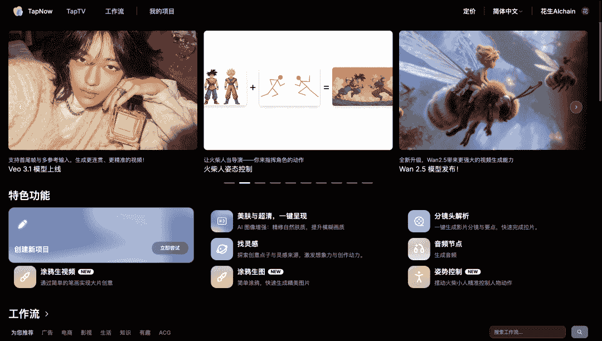
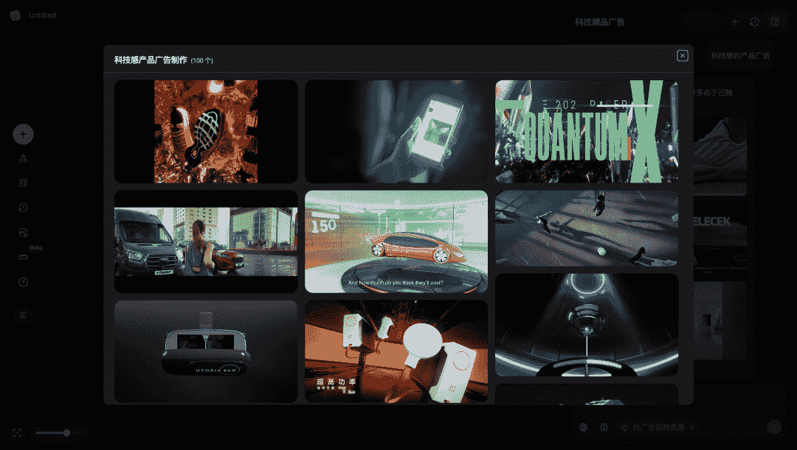
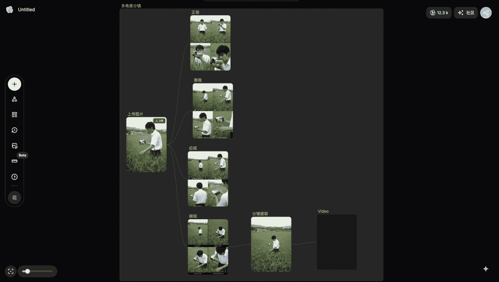
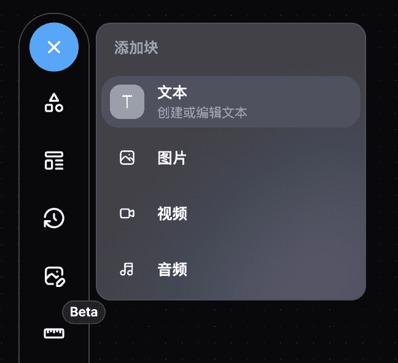
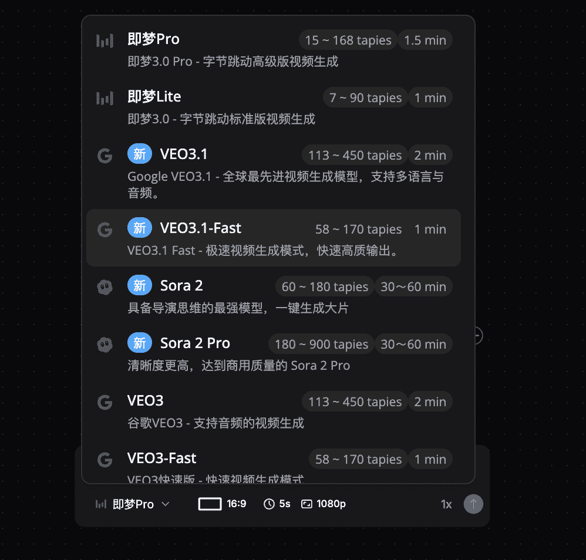
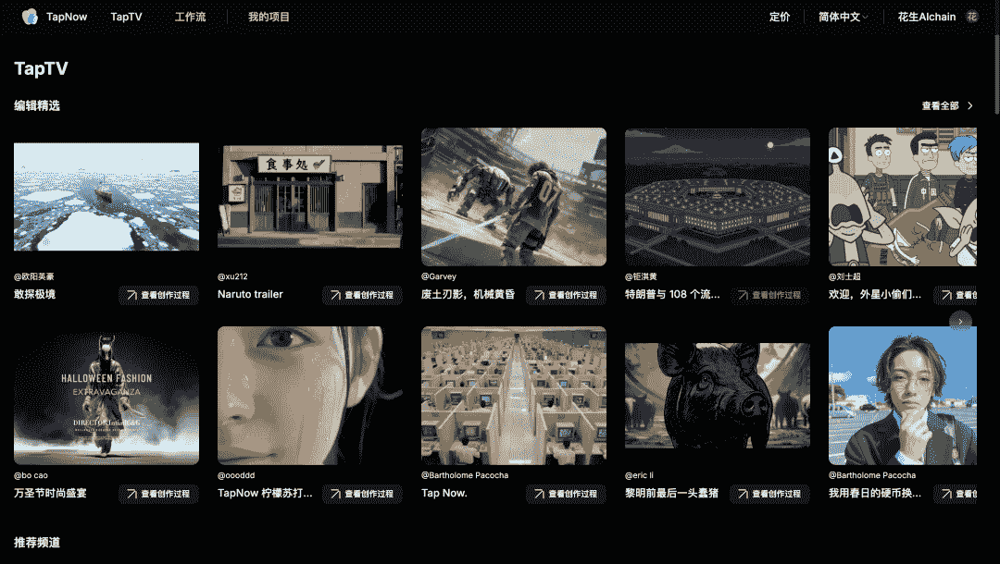
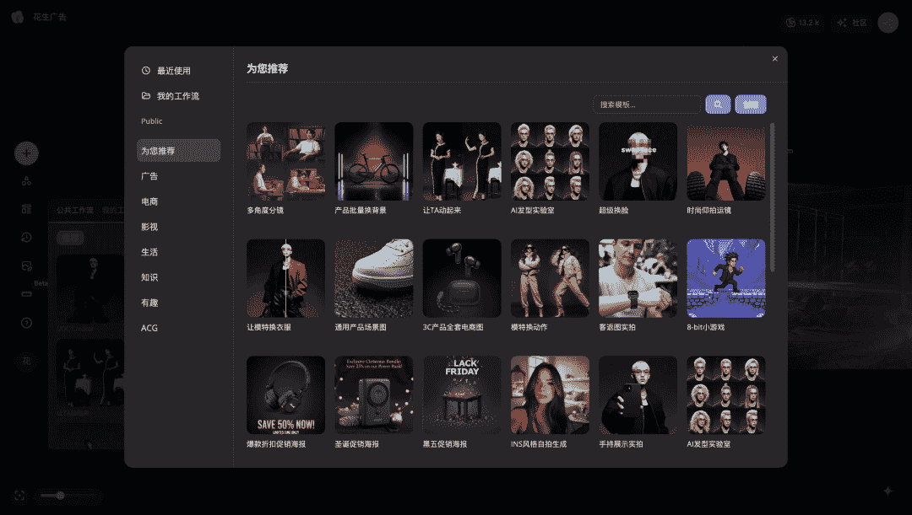

# 从Sora2到TapNow：AI视频创作，差的是这套专业流程

> 来源：[https://xatc0v8uz5m.feishu.cn/docx/BXfGdIgmqoAKaPxmFXnc2OrlnXg](https://xatc0v8uz5m.feishu.cn/docx/BXfGdIgmqoAKaPxmFXnc2OrlnXg)

> 🔗 原文链接： h[ttps://mp.weixin.q](https://mp.weixin.qq.com/s/EXh_dticR6T948FongIGAg)q.com/s/EXh_dtic...

> ⏰ 剪存时间：2025-11-07 12:11:43 (UTC+8)

> ✂️ 本文档由 [飞书剪存 ](https://www.feishu.cn/hc/zh-CN/articles/606278856233?from=in_ccm_clip_doc)一键生成

原创 花叔 花叔2025年11月7日 08:04

最近看到一个挺震撼的案例。

据TapNow介绍，国内知名导演欧阳英豪用AI打造了首个百万级商业TVC——南极探险主题，影视级画质，完整叙事，商业可用。欧阳英豪是新片场认证导演，代表作包括DJI、中国银联的广告，还拿过2023年金麻雀奖。

这支片子不是demo，是真正的商业项目，也是目前全世界价值最高的纯AI TVC。

更有趣的是，TapNow把这个项目创作的所有AI流程都在社区公开了。你可以直接到他们的官网上完整查看，甚至复制这个TVC用AI制作的全流程（非常适合用来学习）。

你可以直接通过这个链接去看看导演是怎么把这个百万级的TVC搭出来的：https://app.tapnow.ai/#/home/taptv/1/6c455902-0822-48c1-9a68-4c2f3da1754e?tap_referral=huas

并且，不止于此。

据我了解，TapNow做出了全球第一个视频创作开源社区。

像是之前做了全网爆火的《Rick&Morty》上海视频的B站up主梦游牛油果频道，审美艺术性极强的initialC老师的万圣节，以及商业风格导向的京东TVC，你都可以在这个社区一比一复刻学习。

这让我想到一个问题：同样是AI工具，为什么导演能做到这个程度，但大部分人做的还是"demo级"？

2025年10月，Sora2和Veo3.1发布。AI视频市场快速增长，2025年预计$717M。据一些科技媒体报告，53.1%的广告主已在使用AIGC技术。

工具确实很强。10秒生成视频，画质专业。

但现实是：真正能用于商业的TVC极少。

差距在哪？为什么工具这么强，大部分人还是做不好商业TVC？别人是怎么做到的？

## 核心问题：不是工具不行，是不懂专业流程

AI解决了生成问题，但没解决"怎么做"的问题。

商业级TVC需要什么？

分镜设计——该拍什么镜头？怎么组合？

运镜控制——推拉摇移怎么用？表达什么情绪？

节奏把握——该快还是慢？哪里转场？

质感优化——怎么让画面看起来"专业"？

AI已经能做视觉生成、基础运镜、声音生成。Sora2、Veo3.1，以及国内的即梦、可灵都能10秒生成视频，画质和主体的一致性都能做到相当不错的水平。

但AI还做不好的是：

+   不知道该拍什么镜头

+   不知道该用什么运镜

+   不知道该怎么把控节奏

+   不知道该怎么优化质感

问题本质：不是工具不行，是 **不懂专业流程 **。

Sora2/Veo3.1给了你画笔，但没教你怎么画画。

你能生成一个镜头，但不知道这个镜头该放在哪里、该和什么镜头组合、该用什么节奏。结果就是：画面很炫，但不能用。

## TapNow的解决方案：把专业流程工具化

TapNow不只是生成工具，而是"专业流程的工具化"。

它想做的事情是：让不懂导演思维的人，也能做出专业级TVC。

怎么做到？把TVC制作的专业流程，拆解成工具。

五大核心功能，对应 TVC 制作流程 ：

**1、找灵感**

TapNow收集了人类历史上大量的广告视频和电影镜头，让你可以用自然语言去找寻灵感。

以前找参考案例，要去YouTube、B站翻半天。现在直接输入"科技感的产品广告"、"情感化的品牌片"，就能找到对应的案例。

|  |  |
| --- | --- |

**2、一键拉片（分镜头解析）**

在TapNow找到合适的广告片，或者你自己上传广告片之后，可以让TapNow自动分析分镜/文案/节奏，再自动倒推提示词。

这个功能我觉得很关键。它把导演的思路可视化了。

你上传一个优秀的TVC，TapNow会自动分析：这个片子用了哪些镜头、每个镜头的构图是什么、节奏是怎么把控的。然后倒推出提示词，告诉你"如果用AI做，该怎么描述这个镜头"。

相当于把导演的脑子翻译成了AI能理解的语言。

**3、Storyboard**

你可以在TapNow上管理分镜，可视化整理创意思路。

TVC不是生成一个镜头就完事了，而是很多镜头的组合。Storyboard帮你把这些镜头可视化管理起来，看到整个片子的结构。

**4、All in one画布**

文字 → 图片 → 视频 → 声音，一站式完成。

以前做视频要跳转多个工具。AE做特效、PR剪辑、达芬奇调色、Audition做声音。

现在一个画布搞定。从脚本到成片，不用跳出这个平台。

以AI视频为例，你可以在这里用到Veo3.1、Sora 2 Pro、即梦Pro、可灵等几乎所有最出色的AI视频生成模型，充分利用各类模型自身的优势。

**5、开源创作社区**

相比Sora2做了个类抖音的AI内容信息流，我觉得TapNow的开源社区对我而言更有价值。从TapTV频道你不止可以看到社区精选出来的其他人用AI创作的TVC广告，你甚至还能查看其他人完整的创作流程，也可以去复制使用其他人的工作流模板，从案例中学习专业流程。

这就回到开头的那个案例。欧阳英豪的百万级TVC，所有流程都开源了。

这里再给大家推荐几个风格迥异，但我觉得做得非常出色的视频短片（不止是TVC！）：

百事可乐TVC广告：https://app.tapnow.ai/#/home/taptv/1/160d2306-d788-4925-8981-f3639c99bd5a?tap_referral=huas

Rick&Morty风格的动画：https://app.tapnow.ai/#/home/taptv/1/de1c9c5e-008e-40d1-9629-6c680dcfe8aa?tap_referral=huas

真假难辨的KPOP MV：https://app.tapnow.ai/#/home/taptv/1/6c6f2c40-509f-4a09-a5ef-68522997762d?tap_referral=huas

你可以看到导演是怎么设计分镜的、用了什么运镜、怎么把控节奏的。不只是看，还能复制工作流模板，直接用在自己的项目里。

## **TapNow适合谁用？**

我觉得它覆盖了三种层次的创作者，每个人的使用方式不太一样。

如果你是专业创作者，想做影视级TVC ：

你可能已经有导演思维了，知道该怎么设计分镜、怎么把控节奏。TapNow对你的价值是：大幅提升效率。

传统流程，从脚本到成片，可能需要几周。要组建团队、协调拍摄、后期制作。现在用AI，几天就能完成。

你可以用"一键拉片"学习其他导演的案例，用Storyboard管理整个项目的分镜，用运镜控制实现你想要的镜头效果。省下的是执行时间，专注的是创意本身。

如果你是品牌营销人员，需要快速产出内容 ：

你可能不懂专业的TVC制作流程，但需要定期产出品牌视频。以前要么外包（成本高、周期长），要么用模板（千篇一律、没特色）。

TapNow的社区案例和工作流模板，相当于给了你一套"半成品"。你可以参考别人的案例，下载工作流模板，稍微调整一下，就能出片。不需要从零开始学导演思维，但能做出看起来专业的视频。

这种"零专业门槛也能出片"，降低的是学习成本。

如果你是小企业主或个人创作者，想做电商短视频 ：

你可能连什么是"分镜"都不太清楚，就是想快速做个产品介绍视频，或者日常品宣内容。

对你来说，TapNow最大的价值是：快速迭代。选择一套合适的工作流，快速生成视频，不满意就再生成一次。成本低、速度快，试错成本几乎为零。

不是每个视频都要达到"影视级"。有时候你只是想要一个能用的视频，发发朋友圈、发发电商平台。这种场景下，AI的效率优势就很明显了。

## 写在最后

AI让你可以成为一位公司，AI能让你不会写代码就开发产品，同样的，AI现在能让你做出一个专业的TVC广告来了。

我们始终可以期待AI去解锁我们新的创造的可能性。

但你始终需要记住的是，AI降低的门槛是工具操作、制作成本、时间周期。

但创意能力、导演思维、审美判断的门槛，还在。

Sora2/Veo3.1火了，但你还是做不好TVC——差的不是工具，是专业流程。

TapNow通过工具化降低门槛，把导演的思维拆解成可学习、可复用的流程。

**创造力仍是人的 **。

AI是放大器，不是替代品。

**相关链接 **：

TapNow产品官网：https://app.tapnow.ai/?tap_referral=huas

TapNow文档：https://docs.tapnow.ai/zh