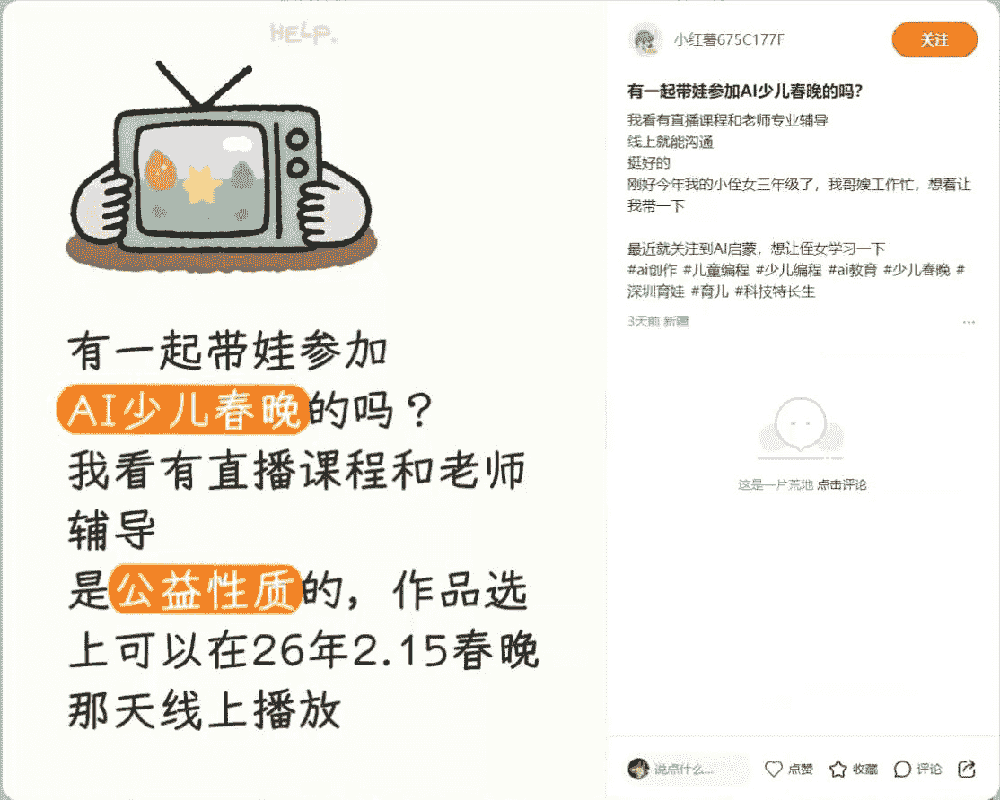
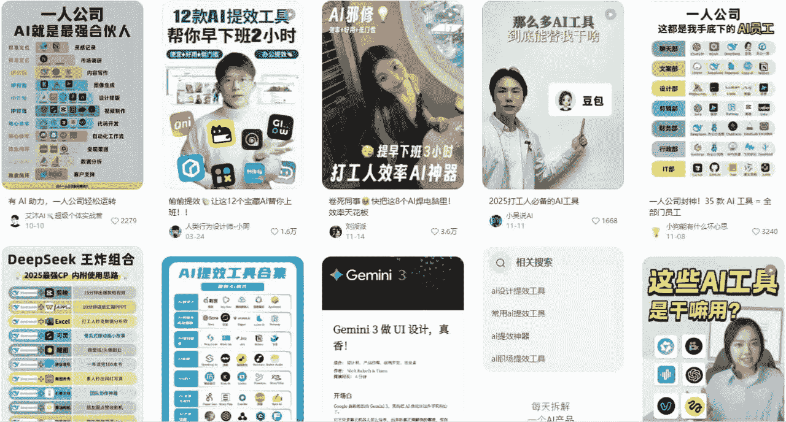
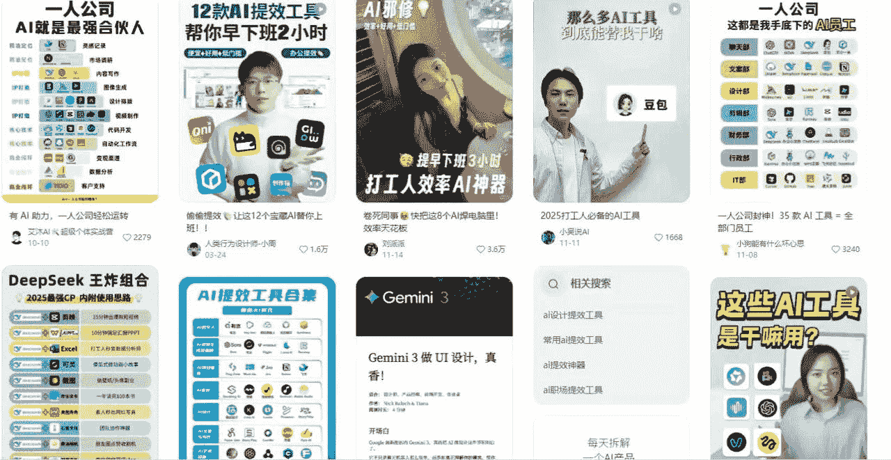
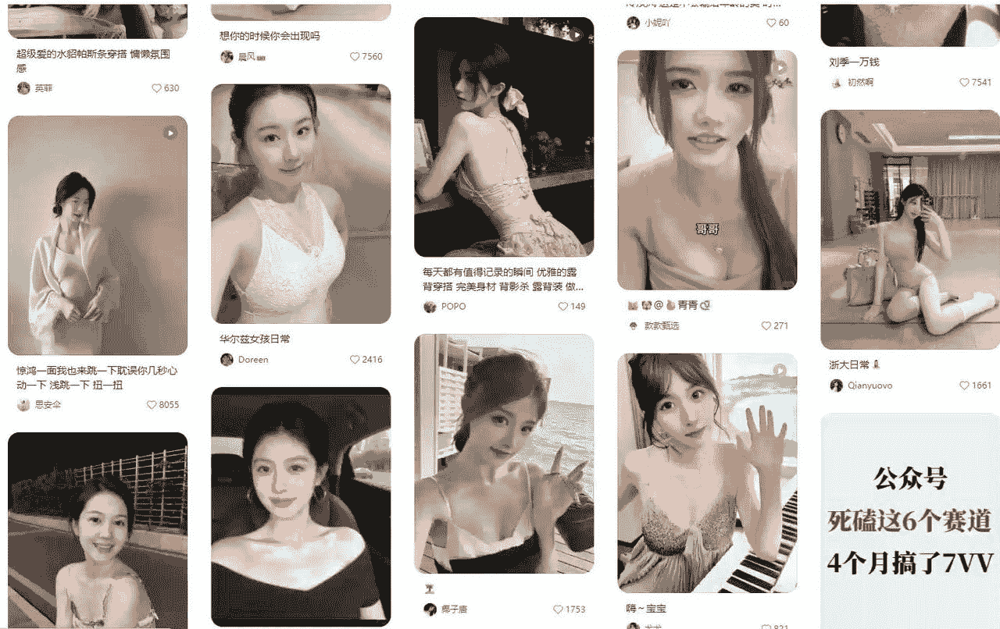
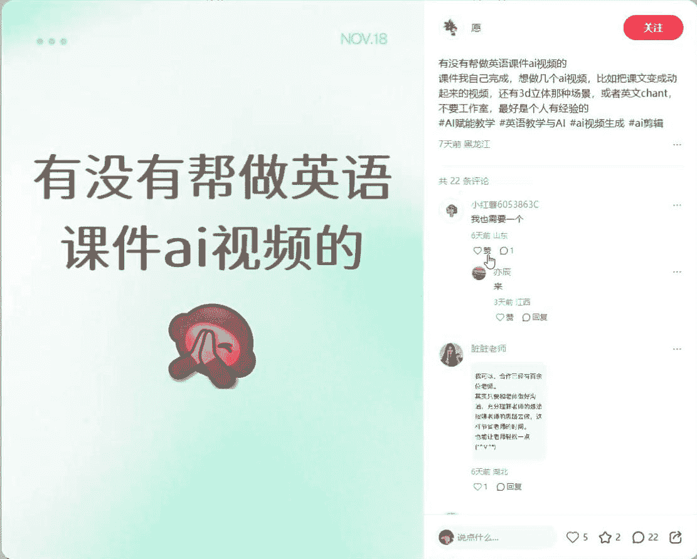
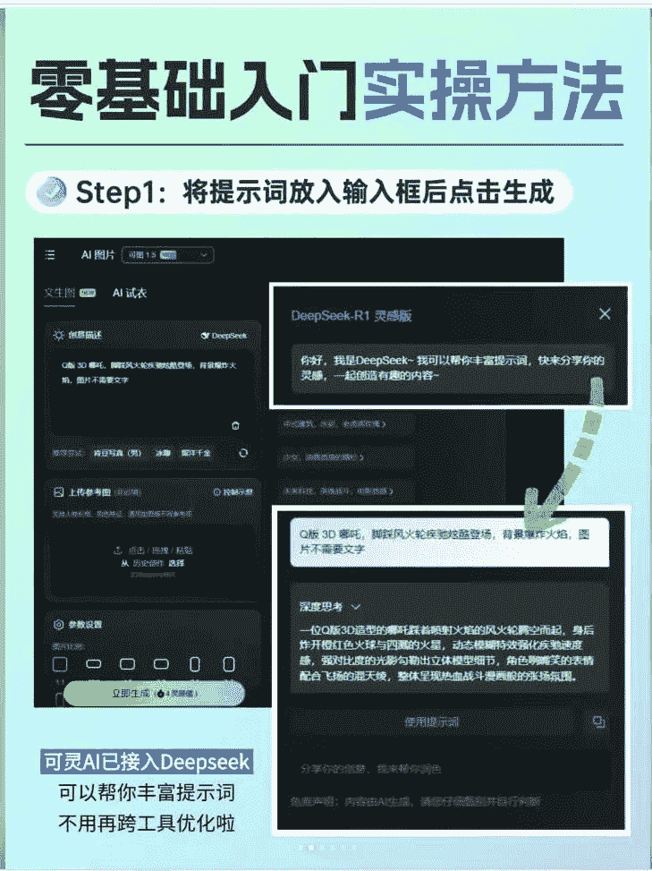
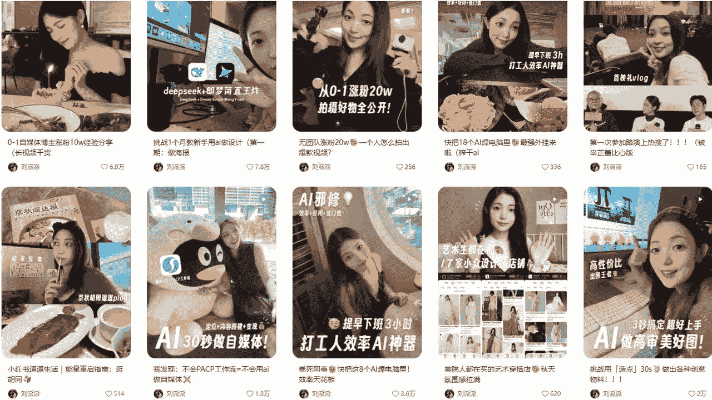
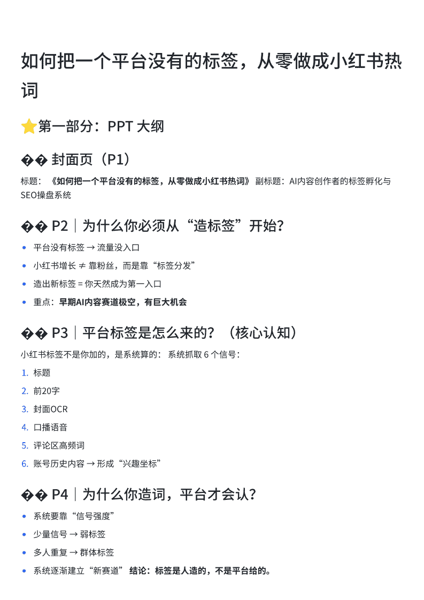

# 📕运营

> 来源：[https://xatc0v8uz5m.feishu.cn/docx/J4CddHXkgoiKQXxYxO1cu1ynnfg](https://xatc0v8uz5m.feishu.cn/docx/J4CddHXkgoiKQXxYxO1cu1ynnfg)

# 总结

本次会议围绕📕平台的标签运营、标题模板、流量玩法、宣发策略以及合作方案、直播筹备等内容展开交流讨论，分享了相关经验和方法，并明确了后续工作重点，内容如下：

+   **📕标签运营**

+   **标签形成机制**

+   多位置植入关键词：石博（维克多）提出，平台标签的形成需在📕笔记的标题、前 20 字、笔记内容及评论区高频词中植入足够量的特定关键词，如少儿 AI、少儿春晚等内容，平台才会收录成标签并形成后缀。

+   大量笔记累积：实操中需靠大量笔记累积，无捷径可走，大品牌也会花钱找 KOC 打标签词提升热度，如羊毛品牌通过与 KOC 合作种草打爆品类。

+   **标签热度打造**

+   关联泛 AI 领域：以 AI 少儿春晚为例，可关联泛 AI 领域的关键词，如 AI 教程、AI 生成 PPT 等，二三十位同学每天更新相关泛标签内容，可带动 AI 少儿春晚标签的形成。

+   利用已有标签生态：可将 AI 少儿春晚与平台已有的科普、编程、教育、少儿培训、儿童绘本等标签内容打包，把冷门词做成相对热词。

+   **标签 SEO 作用**

+   持续流量获取：关键词 SEO 可带来持续的流量，当用户搜索关键词时，关联标签下的笔记会形成长尾流量，即使平台未在推荐中推广，也可能因标签词高频而被推到前面。

+   精准推荐：平台根据笔记的标题、前 20 字、封面、评论区高频词和标签等信息，通过算法抓取形成推荐算法，精准推荐给目标用户。

+   **AI 内容创作者标题模板**

+   **模板类型及示例**

+   定义型：如“什么是 AA？少儿春晚一篇讲透”，可用于定义相关概念。

+   教程型：像“少儿学 AI 最核心的哪三个步骤？”“少儿从零上手 AI 编程，小白也能做”等，适用于教授知识和技能。

+   案例型：例如“我家小孩用 AI 编程后一个月发生的什么什么变化”，通过实际案例吸引读者。

+   避坑型：如“90%的家长让孩子学 AI 的编程或者 AI 教程，孩子极度反抗，都因为死在了这三点”，帮助读者避免常见问题。

+   深度洞察型：如“少儿学 AI，其实也是一种很新的内容生产方式，为什么未来半年爆火”，提供深入的分析和见解。

+   **模板优势**：这些模板降低了 AI 内容创作者发笔记的标题制作门槛和 SEO 门槛，可直接参照使用。

+   **📕流量玩法**

+   **矩阵号铺量**：除了 SEO 和关键词策略，还可通过做矩阵号铺量实现 AI 人效覆盖，如美妆号通过批量自动化生产内容并分发到📕账号，形成流量垄断。

+   **用户互动引导**：引导用户在笔记下互动，如扣 1 表示想要教程等，可提高帖子的推荐算法权重，增加搜索流量曝光。

+   **📕宣发策略**

+   **官号**：石博（维克多）认为，官号主要负责品牌口碑传播，如与大媒体、科技媒体或大 AI 博主合作，制造话题，蹭已有 IP 的流量。

+   **矩阵号**：矩阵号用于内容铺量，通过发布类似少儿 AI 课程、少儿 AI 编程等内容，蹭成熟大类目底下的流量。

+   **合作方案与权益**

+   **外联组方案制定**：洪提出，外联组若有与媒体、KOL 合作及赞助方面的需求，先列出认为合理的权益方案，总部再进行评估和调整，以加快工作推进速度。

+   **现有方案情况**：谢镇宇表示，目前已做出针对学校和机构的两版合作方案初稿，后续外联组需细化与媒体、KOL 合作及赞助方向的方案。

+   **直播筹备工作**

+   **本周工作重点**

+   内容组工作：谢镇宇指出，本周内容组的重点是学生组间进组、收集组长们的视频进行汇剪。

+   直播筹备：宣发组需根据直播内容制作不同的海报进行宣传，本周要做好直播的筹备工作。

+   **课纲制定要求**：洪强调，需要制定直播的大课纲，明确每一期的教学方向，如第一期、第二期教怎么做图，第三期教怎么做视频等，让孩子们每期能学到不同内容，也便于宣发组宣传。

+   **其他问题交流**

+   **AI 图文对流量的影响**

+   影响因素：大风提出 AI 生成图文对流量的影响问题，石博（维克多）认为，这主要取决于内容的关联性和粗糙程度，一眼假的内容平台不会推流，与是否为 AI 制作关系不大。

+   图文数量与搜索：对于图文数量，石博（维克多）表示，用户搜索关键词时主要看首图，首图吸引力对流量影响较大。

+   **引导至私域的方法**

+   未认证账号：未完成企业认证的账号，可通过群聊、at 小号引导用户加🛰️或 🐧 等，在内容底下置顶小号评论或在主页 at 小号。

+   认证账号：认证账号花 600 元后可直接通过私信导私域。

+   **后续工作计划**

+   **外联组**：细化与媒体、KOL 合作及赞助方向的权益方案，列出初稿供总部评估。

+   **内容组**：完成学生组间进组工作，收集组长们的视频进行汇剪。

+   **宣发组**：根据直播课纲内容制作不同的海报，筹备直播宣传工作。

+   **资料整理**：将维克多老师的讲课视频进行剪辑并发布，供未参加会议的人员学习。

[如何把一个平台没有的标签，从零做成📕热词.pdf](https://internal-api-drive-stream.feishu.cn/space/api/box/stream/download/all/A0UTbvW2PoK5icxFdxCcMW4zneb)